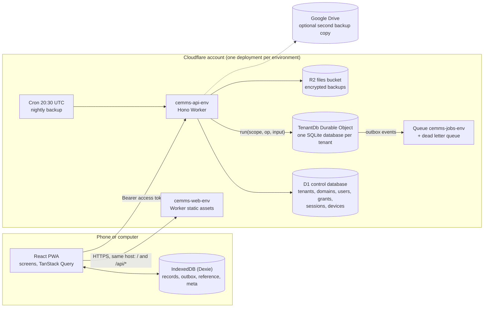
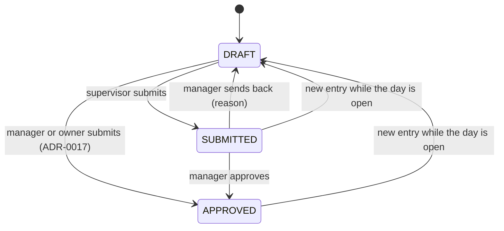

# CEMMS Technical Architecture

Status: current as built on 30 October 2026 (Phase 1A on staging; production not created yet).
Owner: project lead (Muthu Kumar). Source of truth for what exists is the code; this document explains how it fits together and why. Reasons for each choice are in `docs/decisions/` (ADR-0001 to ADR-0022). Business scope and open owner questions are in `CEMMS-IMPLEMENTATION-PROMPT.md` and `docs/owner-confirmations.md`. Build progress is in `docs/implementation-status.md`.

Where this document and the older architecture document (Google Drive, revision of 27 October 2026) differ, this document describes what is built; differences are listed in section 17.

## 1. Purpose and scope

CEMMS is a multi-tenant system for coffee (and pepper) estates. Phase 1A, the part that is built, covers: sign-in and roles, estates, fields, varieties, jobs and workers (with CSV import), the Day and Night attendance registers, plucking weigh-ins (the evening muster), the Daily log, offline capture with sync, audit and history, a daily summary and Excel exports, and backups.

Phase 1B (washing, processing routes, packing, tracing, QR) and Phase 2 (roasting, delivery) are designed but not built (section 16).

Quality goals, in order: no lost or silently changed data; one tenant can never see another's data; works with poor or no signal; fast and simple for a supervisor with a phone; safe to run for many estates with one deployment.

Availability 99.5% and p95 under 500 ms are proposed targets, not commitments.

## 2. System at a glance

Everything runs on Cloudflare (ADR-0001). The web app and the API share one host name per tenant: the host serves the web app at `/` and the API at `/api/*`. Because they share an origin, no cross-origin requests are allowed.

## 3. Technology

| Layer | Choice | Notes |
|---|---|---|
| Language | TypeScript 6, strict | npm workspaces (ADR-0002) |
| API | Hono 4 on Cloudflare Workers | REST JSON under `/api/v1`, OpenAPI document generated from the routes |
| Validation | Zod 4 | Schemas shared by API and web in `packages/contracts` |
| Control data | Cloudflare D1 | Wrangler migrations in `apps/api/db/control` (2 so far) |
| Tenant data | SQLite-backed Durable Object `TenantDb`, one per tenant | Drizzle ORM; migrations in `apps/api/src/tenant/migrations` (8 so far) |
| Files and backups | R2 | Encrypted copies, manifests |
| Jobs | Queues, Cron Triggers | Outbox delivery, nightly backup |
| Limits | Workers rate limiting binding | Login 20 per minute, API 600 per minute per binding |
| Web | React 19, Vite 8, Tailwind 4, TanStack Query 5 | Hand-built UI components |
| Offline | Dexie 4 over IndexedDB, vite-plugin-pwa 2 (Workbox) | Prompt-style updates |
| Tests | Vitest 5; API tests run inside workerd with real D1 and Durable Object SQLite | |
| Lint and format | Biome 2 | |

Not used: NestJS, AWS, Redis, PostgreSQL, Expo, SQLite on the phone, KV (the platform allows it as a short-lived cache; nothing needs it yet).

## 4. Repository and module boundaries

| Path | Contains | May import |
|---|---|---|
| `packages/domain` | Pure rules with no I/O: weights in grams, attendance states, permissions, settings and gates, CSV parsing, sync contract, ids, dates | nothing outside itself |
| `packages/contracts` | Zod schemas for requests and sync payloads | domain, zod |
| `apps/api/src/routes` | HTTP routes: parse, call, return JSON | `callTenant` and control modules; never tenant modules |
| `apps/api/src/auth`, `src/control` | Sign-in, sessions, devices, users, tenant registry | domain, contracts, core |
| `apps/api/src/tenant` | `TenantDb`, migrations, operation dispatcher, business modules | domain, contracts, core; never control or routes |
| `apps/api/src/core` | Errors, logging, crypto, site resolution, backup, Google Drive upload, Excel writer | |
| `apps/web` | Screens, outbox, sync engine, PWA | domain, contracts; talks to the API over HTTP only |

`npm run boundaries` (`scripts/check-boundaries.mjs`) fails the build if a package imports where it should not.

Request path inside the API: route, then `callTenant` (verified scope), then `TenantDb.run(op)` (input schema and tenant check), then a module service (permission check, validation, transaction, audit, revision, outbox event), then Drizzle calls.

Tenant modules: `organization` (masters), `imports` (CSV), `attendance`, `muster` (plucking weigh-ins), `dailylog`, `sync`, `reports`, `history`, `settings`, `capture` (date rules).

## 5. Multi-tenancy

- **One deployment serves every tenant.** A new tenant is data, not a deployment: `POST /api/v1/platform/tenants` creates registry rows and its own database at runtime (ADR-0010).
- **The site address decides the tenant.** `tenant_domains` in the control database maps a host name to a tenant. On a mapped address the sign-in asks only for user name and password. On an unmapped address (local development) a group code is also asked.
- **Tenant authority comes only from a verified token.** The access token carries tenant, user, session and device ids and is bound to the site origin (audience). The API never reads a tenant id from the caller's request body or URL to decide which database to open.
- **One Durable Object per tenant**, addressed by the name stored in the registry (`tenants.db_name`) with a placement hint of Asia-Pacific. `callTenant` builds an immutable `Scope` (tenant, user, session, device, grants, request id, environment) and `TenantDb.run` refuses a scope for another tenant. A request can open only its own tenant's database; handles are never shared across requests.
- **Defense in depth.** Business rows also carry `tenant_id` (and `estate_id`), foreign keys stay inside the tenant database, and estate ids from another tenant resolve to "not found".
- **Estate scope.** Roles are granted per estate or tenant-wide; every service call and every sync item is checked against the caller's grants.
- **Platform staff** have no tenant data permissions; support access with a time-limited audited grant is not built.
- Asia-Pacific placement is not an India-only residency guarantee and must not be described as one.

Tested by `apps/api/test/isolation.test.ts`, which covers every tenant route and the Durable Object directly.

## 6. Data architecture

### 6.1 Control database (D1)

Tables: `tenants`, `tenant_domains`, `users`, `user_grants`, `devices`, `sessions`, `refresh_tokens`, `platform_audit`. Passwords are stored only as hashes, refresh tokens only as SHA-256 hashes, authenticator secrets encrypted (AES-GCM). Diagrams are in `docs/architecture/erd.md`.

### 6.2 Tenant database (Durable Object SQLite)

| Group | Tables |
|---|---|
| Masters | `estates`, `fields`, `field_subdivisions`, `field_varieties`, `varieties`, `job_types`, `workers`, `worker_estates`, `log_kinds` |
| Operations | `attendance_sheets`, `attendance_records`, `muster_entries`, `dailylog_entries` |
| History and trust | `record_revisions` (every version, append-only), `audit_log`, `outbox_events` |
| Sync | `sync_mutations` (stored acknowledgements, primary key device and mutation), `sync_conflicts`, `device_status` |
| Configuration | `settings`, `gate_confirmations`, `tenant_meta` |
| Operations support | `import_runs` (CSV imports are idempotent by file hash), `_migrations` |

### 6.3 Data rules

- **IDs:** UUIDv7 text. Records created on a phone carry their id from the start, so a retry never creates a second row.
- **Quantities:** integer grams in storage and arithmetic. Input is parsed from a decimal string with at most three decimals (no floating point). Daily log readings are an integer plus the kind's decimal scale (ADR-0007).
- **Weigh-in arithmetic:** the database enforces `net_g = gross_g - tare_g` and non-negative values.
- **Time:** ISO text. Each estate has a time zone; "today" and the end of a business day are computed in the estate's time zone.
- **Human-readable codes** (worker `GLZ001`, field codes) are allocated by the server inside the transaction.
- **Submitted data changes only by append.** A correction, removal, void, reopen or conflict decision writes a `record_revisions` row (with reason) and an `audit_log` row (actor, time, before and after). Nothing is overwritten without a trace.
- **Deleting** a worker or field is allowed only while nothing refers to it, with a reason; anything used is set Inactive (ADR-0011).
- **Transactional outbox:** each applied change writes its `outbox_events` row in the same transaction. Events are then sent to the queue. At present the queue consumer only logs the events; no downstream consumer exists yet (Phase 1B will use it for trace snapshots and notifications). Consumers must be idempotent.

### 6.4 Migrations

Tenant migrations are ordered TypeScript SQL strings applied by each `TenantDb` in its constructor inside `blockConcurrencyWhile` and a single transaction; the single-threaded object is the lock (ADR-0005). `_migrations` stores version, name and checksum; a checksum mismatch stops that tenant with `MIGRATION_FAILED`, visible in the health call, never a half-applied state. Changes follow expand, backfill, contract and stay compatible with the previous Worker version. Control migrations use Wrangler D1 migrations.

## 7. Security

### 7.1 Authentication (ADR-0004, ADR-0009)

- Passwords: PBKDF2-SHA256, 600,000 iterations as six chained rounds of 100,000 (Workers refuse more per call), random salt, WebCrypto. Same response for an unknown user and a wrong password.
- Access token: HS256 JWT, 15 minutes, held in memory by the web app only; never in IndexedDB or localStorage.
- Refresh token: random 256-bit value in an httpOnly, Secure, SameSite=Strict cookie scoped to `/api/v1/auth`; stored hashed, rotated on every use; reuse of a spent token revokes the session.
- CSRF: refresh and logout need `X-CEMMS-CSRF: 1` and a same-origin `Origin`; API calls use the Bearer header.
- Lockout: five failed sign-ins lock the account for 15 minutes; also per-IP and per-user rate limits.
- Every request re-checks that the session is not revoked, the device is not revoked and the user is active (fail closed).
- Sessions last 12 hours by default (`auth.offlineSessionHours`); longer offline windows stay blocked until the owner answers OC-101.
- Devices: each browser install registers a device id; a session is bound to its device; a device belongs to one tenant.
- MFA: TOTP. `MFA_ROLES` per environment decides which roles must use it; production enforces Owner and Platform Admin. Used codes cannot be replayed.

### 7.2 Authorization (`packages/domain/src/permissions.ts`)

Roles: Platform Admin, Owner, Estate Manager, Field Supervisor, Processing Operator, Quality Officer, Packing Operator, Auditor. Permissions are checked in routes, services and sync items, scoped to estate or tenant. Examples: a supervisor can capture and submit attendance and weigh-ins; approving, correcting, managing masters and exports need manager or owner; settings and go-live answers are owner-only; user management is owner-only (ADR-0003 and later decisions).

### 7.3 Transport, browser and API hardening

- TLS only; HSTS. The web app sets a strict Content-Security-Policy (`default-src 'self'`, no inline scripts), `X-Frame-Options: DENY`, `nosniff`, no referrer, and denies camera, microphone and location. API responses carry `default-src 'none'`.
- Input is validated with Zod at every boundary and revalidated by services. CSV imports refuse formula-leading cells and are limited to 1 MB and 5,000 rows, previewed before commit, applied in one transaction.
- Logs are structured JSON with request id and scoped tenant, user and estate ids; the logger redacts names, remarks, payloads, tokens and passwords.
- `docs/security/threat-model.md` and `docs/security/data-classification.md` list threats, controls and known gaps.

### 7.4 Known gaps

No local PIN lock on the phone; backups are encrypted with the same key as authenticator secrets (a separate key is planned); WAF rules and account settings are not in code; dependency checking is CI's `npm audit` and secret scan only; the public QR trace route does not exist yet.

## 8. Offline-first and sync (ADR-0006)

### 8.1 On the phone

IndexedDB (Dexie) holds four stores:

- `records`: the local copy of each captured record with a status: waiting, accepted, rejected or conflict.
- `outbox`: queued mutations (waiting, then accepted, rejected or conflict) with attempt count and next retry time.
- `reference`: cached masters (workers, fields, varieties, jobs, settings rules such as the tare and whether variety is required).
- `meta`: small values such as the cached sheet state, whether a day is still open, and the previous day's field and job.

Every local change writes the record and the outbox mutation in one IndexedDB transaction before the screen says "Saved on this phone". The screens keep waiting, accepted, rejected and conflicting entries visibly different and never show a waiting entry as accepted. Totals on the dashboard and reports count only what the server has accepted.

### 8.2 The mutation

Each mutation carries a stable `mutationId` (UUIDv7), `entityType`, `entityId`, `op`, `estateId`, `deviceId`, `schemaVersion`, `capturedAt`, `baseVersion`, `payload` and a SHA-256 `payloadHash`.

| Operation | Meaning |
|---|---|
| `attendance_record:upsert` | Mark or change one worker for a day and shift |
| `attendance_record:void` | Take a mark off again (double-click on the chosen button) |
| `attendance_sheet:submit` | Submit a day's register |
| `muster_entry:create` / `:void` | Record or cancel a weigh-in |
| `dailylog_entry:create` / `:void` | Record or cancel a Daily log reading |

### 8.3 Pushing and applying

- The phone pushes batches of up to 100 on app open, window focus, coming back online, every minute while open, and the Sync now button. There is no reliance on Background Sync (iOS Safari lacks it). Failed attempts back off exponentially with jitter.
- The server applies each mutation in its own transaction together with its outbox event and its stored acknowledgement. A repeat of the same `(deviceId, mutationId)` returns the stored acknowledgement; a reused id with different data is refused.
- Results are per item, so a batch can partly succeed: `accepted` (with the new version), `rejected` (error code and field errors) or `conflict`.
- Mutations must come from the session's own device; a revoked device cannot sync.
- A mutation whose `capturedAt` is more than 10 minutes in the future is refused (clock skew); one older than 8 days is refused as too old.

### 8.4 Conflicts

Two phones marking the same worker and day, or an edit based on an out-of-date version, never pick a winner: a `sync_conflicts` row keeps both versions, the sheet shows how many are open, and a user with `conflicts.resolve` chooses with a reason. A manager's submit stays unapproved while conflicts are open.

### 8.5 When a day can still be changed (ADR-0022)

| Case | Rule |
|---|---|
| Date a phone may capture for | The device's local date, plus `attendance.backEntryDays` earlier days (default 0, open question OC-86). Managers may enter missed days up to 31 days back. |
| Submitted day, same business day | Still takes entries until the day ends in the estate's time zone. An entry sends the sheet back to Draft (audited as a reopen); submit again. Submitting again with nothing new is accepted and changes nothing. |
| Submitted day, earlier day | Stays open for as many days as `attendance.backEntryDays` says; otherwise closed. |
| Closed day | New entries and unmarks are refused with `SHEET_LOCKED`. A manager changes a saved entry with Edit (a correction with a reason) or removes it with Delete. |

An entry captured offline before midnight but synced after it, on a day that was already submitted, is refused and shown as not accepted; a manager enters it as a correction.

## 9. Business flows

### 9.1 Attendance

One register per estate per day for Day and one for Night (ADR-0014); a worker can have a row in each. A worker allotted to several estates cannot be present in two estates in the same shift (ADR-0013). Each worker gets a status (Present, Half day or Absent are offered), a field and a job; a day starts from the previous recorded day's fields and jobs.

After the day is over, only a correction or removal with a reason changes a record; both are append-only.

### 9.2 Plucking weigh-in (evening muster)

A weigh-in names the worker, estate, field, crop (Coffee, Pepper where enabled), variety, bags, gross weight, bag weight (tare) and remark. Net is gross minus tare (tare is one figure per weigh-in, not per bag). A variety is required by default (ADR-0018). Tare is one tenant setting for all estates set in Masters; supervisors always get the tenant default, and users with `muster.correct` may enter another figure (ADR-0021). The worker list on the form shows only workers marked present that day, with a link to show everyone when attendance was missed. A weigh-in is never edited in place: it is corrected with a reason or cancelled, and the table shows a change history built from `record_revisions`.

### 9.3 Daily log

Readings (such as rainfall or temperature) by kind, date and time, with the kind's value type, decimals and range. Kinds are managed by managers and owners. Entries are created offline and cancelled by void with a reason.

### 9.4 Reports and exports

Dashboard and daily summary counts use only server-accepted records. The plucking report has charts and a table with filters for a date range of up to 93 days. Excel exports (old daily-sheet layout and a new-format backup) are generated on request, role-gated, audited and not stored (ADR-0015).

### 9.5 Configuration and gates (ADR-0008)

Behaviour the owner has not confirmed is a tenant setting with a `basis` (confirmed, proposed or tenant choice) and the owner question it depends on. In production, a proposed setting whose gate is open cannot be switched on; the API answers `GATE_NOT_CONFIRMED`. Development and staging may try proposed values. `GET /admin/readiness` lists open gates that block production. Owner answers are recorded in `docs/owner-confirmations.json`, rendered to `docs/owner-confirmations.md`, and in the tenant's `gate_confirmations`.

## 10. API

Base path `/api/v1`. The complete contract is `docs/api/openapi.json` (62 paths), regenerated from the routes and checked by a contract test, so a route change that is not reflected in the document fails CI.

| Group | Examples |
|---|---|
| auth | login, refresh, logout, me, change password, site (tenant name for the host) |
| platform | create tenant, attach address, run backup, list backups, restore into a new database (bootstrap token or platform role) |
| admin | users, settings, go-live gates and readiness, log kinds, backups |
| masters | reference lists, estates, fields, varieties, job types, workers (create, change, delete) |
| imports | templates, preview, commit |
| attendance | register for a day and shift, approve or send back, correct, remove, a worker's recent attendance |
| sync | push, open conflicts, resolve conflict |
| muster | weigh-ins by day or date range, day table, correction |
| dailylog | readings by day or range, correction |
| reports | daily summary, dashboard, plucking, Excel export |
| audit | audit trail, history of one record |

Errors use stable codes (for example `SHEET_LOCKED`, `STALE_VERSION`, `GATE_NOT_CONFIRMED`) with plain messages and field errors where relevant. Rate limits apply to sign-in and to the API in general.

## 11. Web app

One installable React app serves the portal and the supervisor's phone. Screens: Dashboard, Attendance, Plucking (weigh-in, log, charts), Daily log, Reports (summary and Excel), Masters, Users, Manage (import, conflicts, setup, backups), Sync, sign-in and change password.

- Server state uses TanStack Query; local state and offline data use Dexie with live queries.
- A global app context carries the signed-in user, grants, selected estate and date, online status and the device id.
- Tailwind 4 with a warm coffee palette; large touch targets, keypad-friendly weight entry, visible offline and waiting indicators.
- The service worker uses prompt-style updates: a banner offers "Update now". If the normal switch does not reload the page, the app clears its stored copy and reloads. The shell and `sw.js` are served with `no-cache`; API calls are never cached by the service worker.
- Weights are parsed and shown with exact decimal handling (`lib/kg.ts`).

## 12. Backups and recovery (ADR-0016)

| Layer | What it gives |
|---|---|
| Durable Object point-in-time restore | Any point in the last 30 days for a tenant (not available locally) |
| D1 Time Travel | Control database restore |
| Nightly encrypted copy to R2 | Cron at 20:30 UTC: control database (without sessions and refresh tokens) and every tenant database, each encrypted, read back and checksum-compared, with a manifest |
| Optional Google Drive copy | Same encrypted file, uploaded when three Google secrets are set; a Drive failure never loses the Cloudflare copy |

Owners see backups in Manage and can start one. A platform call restores a tenant's newest verified copy into a new, empty database (never the live one) and checks row counts; switching a tenant over is a separate manual step. A restore needs the same tenant migration version. The encryption key `MFA_ENC_KEY` must also be kept outside Cloudflare. Details and the restore drill are in `docs/operations/backup-and-restore.md`.

## 13. Environments, build and release

| | Local | Staging | Production |
|---|---|---|---|
| Address | localhost:5173 (web), :8787 (API) | `glazebrooke-staging.oneuptech.co` | `glazebrooke.oneuptech.co` |
| Workers | `cemms-api-dev`, `cemms-web-dev` | `cemms-api-staging`, `cemms-web-staging` | `cemms-api`, `cemms-web` |
| Control D1 | local | `cemms-control-staging` | `cemms-control-production` |
| Other | R2 `cemms-files-*`, queues `cemms-jobs-*` and `cemms-jobs-dlq-*` per environment | | |
| State | running | running, test data plus the real masters allowed by ADR-0012 | **configured in `wrangler.jsonc`, nothing created yet** |

Only new `cemms-*` resources are used; the older `estate` and `estate-demo` Workers and databases are never bound or changed. Staging never binds production resources. Each environment has its own secrets (`JWT_SECRET`, `MFA_ENC_KEY`, `PLATFORM_BOOTSTRAP_TOKEN`, optional Google secrets). `docs/operations/resource-naming.md` lists everything.

CI (`.github/workflows/ci.yml`): lint and format, module boundaries, owner register is rendered, types, tests (unit, workerd integration, tenant isolation, sync, OpenAPI contract), build, control migrations apply cleanly, dependency audit (fail on high or critical), secret scan. Merges to `main` deploy to staging automatically (control migrations, API, web, health check). Production is a manual run on a protected environment with required reviewers and is never deployed from a pull request.

Release and rollback (`docs/operations/rollout-and-rollback.md`): code rolls back by redeploying the previous Worker version, which still works because migrations are additive; data is fixed forward, or restored into a scratch tenant, never by discarding writes made after the release; phones keep queued entries through any rollback and the server deduplicates them.

Production is the same code base as staging, deployed to its own set of resources with `--env production`; a production bug is fixed on `main`, checked, deployed to staging, then deployed to production after the project lead's go-ahead, with the previous Worker version as the immediate rollback (`docs/operations/rollout-and-rollback.md`, "Fixing a production bug").

Quality gate before any release: `npm run check` (lint, boundaries, register check, types, all tests, build). At this revision it runs 4 tests in contracts, 56 in domain, 73 in the API and 5 in the web package, all passing.

## 14. Observability

Structured JSON logs carry request id and scoped tenant, user and estate ids, with sensitive fields redacted. Workers observability is on. `GET /api/v1/health` is the smoke test, and each tenant database reports its migration state, size in bytes and outbox backlog through a health call. Backup runs write a manifest and log failures as errors. Planned: dashboards and alerts for sync outcomes, outbox and queue lag, backup failures and tenant database size.

## 15. Scalability and limits

- Reads and writes for one tenant are serialized by its Durable Object, which fits an estate's volume (hundreds of workers, thousands of records a day) and makes transactions simple. A tenant database is limited to 10 GB; size per tenant is to be monitored and a larger tenant would need a separately approved design.
- Tenants are independent, so load spreads across objects. Adding tenants needs no deployment.
- Sync batches are capped at 100; reports cap ranges (93 days for the plucking table, 400 days for Excel); CSV imports are capped.
- Workers CPU limits shaped password hashing (six rounds of 100,000).
- Asia-Pacific placement affects latency for users in India but is not a residency guarantee.

## 16. Phase 1B and 2 (designed, not built)

Intake lots and allocations linked to weigh-ins; configurable route templates and versions (coffee Routes A, B and C; pepper open drying); batches, stage runs, measurements, logs, approvals, split and merge; packed lots and pack units with source links; rebuildable trace snapshots and a public QR route that exposes an allowlist only and never worker names; roasting and delivery. All of these attach to the existing weigh-in ids, keep the crop through lineage and use the same patterns: append-only corrections, transactional outbox, idempotent queue consumers, and gates for unanswered owner questions. They are blocked on the owner's answers listed in `docs/owner-confirmations.md`.

## 17. Differences from the earlier architecture document and project rules

| Topic | Earlier text | As built |
|---|---|---|
| UI kit | shadcn/ui, TanStack Table | Hand-built components; no TanStack Table |
| KV cache | Listed | Not used |
| Password hashing | One PBKDF2 call at 600,000 | Six chained rounds of 100,000 (ADR-0009) |
| MFA | All privileged roles | Owner and Platform Admin only, by environment setting |
| Attendance lock | Submitted day closed at once | Open until the day ends; earlier days by setting (ADR-0022) |
| Attendance registers | One per day | Day and Night per estate (ADR-0014) |
| Tare | Per estate (ADR-0019) | One tenant setting set in Masters (ADR-0021) |
| Outbox consumers | Several | Events are written and queued; the consumer only logs |
| Phase 1A date | 1 November 2026 (Sunday) | Staging live; production starts from Monday 2 November once created and the owner confirms the day |

## 18. Open decisions that affect the architecture

- Offline session length (OC-101) and conflict handling choices (OC-103).
- How many earlier days a supervisor may fill in (OC-86); staging uses what the project lead sets under Manage.
- Whether a worker may work half a day in each of two estates (duplicate-attendance policy, OC-103).
- How night watch is counted and paid (payroll is deferred).
- Per-bag tare instead of one figure per weigh-in (OC-19, OC-87).
- Data residency in India (needs a separate PostgreSQL design if required).
- Separate backup key, local PIN lock, support-access grants, WAF rules.
- Moving the Google Drive backup from staging's invalid setup to a working one, and setting it up for production.

## 19. Where things are

| Need | Look at |
|---|---|
| Why a choice was made | `docs/decisions/README.md` |
| What is built and what is open | `docs/implementation-status.md` |
| Owner answers and gates | `docs/owner-confirmations.md`, `docs/owner-confirmations.json` |
| Data model | `docs/architecture/erd.md` |
| Package boundaries | `docs/architecture/modules.md` |
| Terms | `docs/architecture/glossary.md` |
| API contract | `docs/api/openapi.json` |
| Security | `docs/security/` |
| Backups, rollout, names, local run | `docs/operations/` |
| Product scope and rules for contributors | `CEMMS-IMPLEMENTATION-PROMPT.md`, `CLAUDE.md` |
